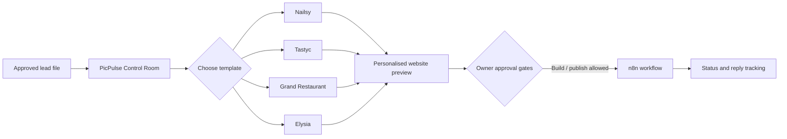

# PicPulse Website Automation System

> Import qualified business data, create a personalised website preview, and manage each build from one control room.


PicPulse is a website-production workflow for small businesses. It accepts an Excel, CSV, or JSON list of approved leads; maps each business to a suitable template; produces a personalised concept site; and records the status of every build, publication, and approved outreach step.

The public repository contains the application and generic template assets only. It deliberately excludes lead lists, customer contact details, generated customer previews, local databases, credentials, live workflow exports, and outreach records.

## What it does

- Imports business records from `.xlsx`, `.csv`, and `.json` files.
- Routes each business to one of four responsive website templates.
- Replaces business name, address, telephone, email, logo, service details, social links, and hours safely.
- Requires explicit verification for logos, owner-supplied images, business email addresses, and public previews.
- Provides an authenticated operations dashboard with website states, email states, activity history, and sent-offer records.
- Prevents duplicate initial offers with durable send locks.
- Accepts n8n callbacks for builds, publications, Gmail confirmation, and matched customer replies.

## Workflow



## Template routing

| Business type | Template | Best for |
| --- | --- | --- |
| `nail_salon` | Nailsy | Nail art, manicure, pedicure, beauty studios |
| `hair_beauty_salon` | Elysia | Hair salons, bridal studios, beauty salons |
| `restaurant_cafe` | Tastyc | Restaurants and cafés |
| `burger_shop` | Grand Restaurant | Burger shops, casual food venues, cafés |

`template_override` can select any template when the automatic category mapping is not suitable.

## Project structure

```text
.
├── public/                 # Dashboard, importer, templates, and static assets
│   ├── templates/          # Nailsy, Tastyc, Grand Restaurant, Elysia
│   ├── dashboard.js        # Control-room interface
│   └── excel-import.js     # Excel, CSV, and JSON parser
├── worker.mjs              # Cloudflare Worker API and renderer
├── schema.sql              # D1 schema
├── n8n-four-template-workflow.json
├── test.mjs                # Isolated regression checks
└── wrangler.jsonc          # Cloudflare deployment configuration
```

## Run locally

Install dependencies with your preferred Node package manager, then start the local preview:

```sh
npm install
npm test
node local.mjs
```

Open `http://127.0.0.1:8098` in your browser.

The local server is for development only. It uses a local SQLite database and does not connect to email or workflow automation services.

## Example input

```json
[
  {
    "lead_id": "DEMO-001",
    "business_name": "Example Nail Studio",
    "category": "nail_salon",
    "area": "Colombo",
    "business_phone": "+94 70 000 0000",
    "business_email": "owner@example.com",
    "business_services": "Manicure; pedicure; nail art"
  }
]
```

For automatic outreach, each business must have an approved, verified email source. An imported file alone cannot grant that approval.

## Deploy to Cloudflare

1. Create a D1 database and update the database ID in `wrangler.jsonc`.
2. Apply `schema.sql` to the database.
3. Add deployment secrets through Cloudflare, never in source files:
   - `ADMIN_PASSWORD_HASH`
   - `API_KEY`
   - `SESSION_SECRET`
4. Deploy with:

```sh
npx wrangler deploy
```

5. Configure n8n separately with its own authenticated credentials and test each action in a non-production environment first.

## Privacy and safety

- Never commit lead files, personal contact details, Gmail exports, customer website previews, API keys, passwords, or databases.
- Keep customer samples private until the business owner approves public access.
- Use only approved logos and images with clear usage permission.
- Treat Gmail acceptance as proof that a message was submitted, not proof of inbox delivery.
- Review every email source before authorising outreach.

## Validation

```sh
npm test
```

The test suite checks template selection, content escaping, import protections, approval gates, publication controls, send locks, reply matching, opt-outs, history preservation, and the four template renderers.

## License

Copyright © PicPulse Studio. All rights reserved.

The included design-template assets may be subject to their original creator licences. Confirm commercial and multi-client rights before using a template for a customer project.
